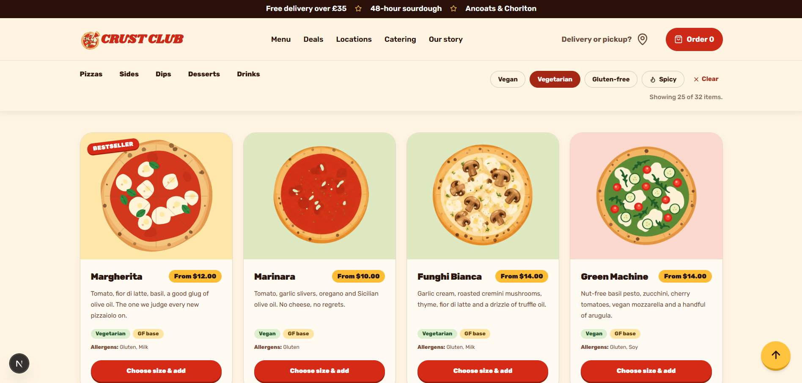
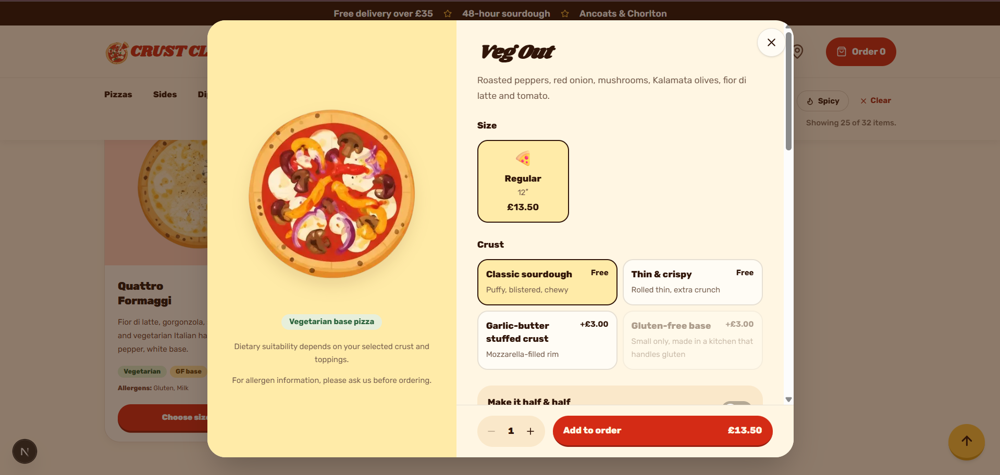

<div align="center">

# 🍕 SLICE PIZZA SHOP


<br/>

**A modern, responsive pizza storefront built with Next.js, React and TypeScript.**

A complete frontend practice project focused on modern web development,
state management, data persistence, form handling and user experience.

<br/>


<br/>


<br/><br/>

</div>

---

## 📸 Project Preview

<div align="center">

### 🏠 Home Page



<br/><br/>

### 🍕 Menu 



<br/><br/>

### 🛒 Shopping Cart


<br/><br/>

### 📦 Checkout Experience


</div>

---

## 🍕 About The Project

Slice Pizza Shop is a modern pizza storefront inspired by contemporary food ordering websites.

The main goal of this project was to build a realistic shopping experience while practicing modern frontend development concepts and creating a maintainable application structure.

Rather than focusing only on the visual interface, this project also explores how frontend applications manage application state, persist user data, handle forms and deal with server-side rendering and client-side hydration.

---

## ✨ Features

- 🍕 Modern pizza storefront and product presentation
- 🎨 Custom pizza-inspired design system
- 📱 Responsive user interface
- 🧩 Reusable React components
- 🛒 Shopping cart state management
- 💾 Persistent cart data using Zustand Persist
- 🔄 Client-side state rehydration
- ⚡ Hydration mismatch handling
- 📝 Form management with React Hook Form
- ✅ Schema-based validation with Zod
- 🎯 Type-safe development with TypeScript
- 🧭 Next.js App Router architecture
- 🎨 Styled with Tailwind CSS
- ⭐ Modern icons with Lucide React

---

## 🛠️ Tech Stack & Implementation

### 1. Next.js

Used as the main application framework.

- App Router for application routing.
- File-system-based routing.
- Nested layouts for shared UI.
- Next.js Image component for image rendering and optimization.
- Server and Client Component architecture where appropriate.

### 2. React

Used to build the user interface through reusable and modular components.

- Functional components.
- React Hooks.
- Component composition.
- Props and state management.
- Separation of UI and application logic.

### 3. TypeScript

Used to improve code reliability and maintainability.

- Explicit type definitions.
- Type-safe component props.
- Typed application state.
- Better development experience and error detection.

### 4. Tailwind CSS

Used for styling and responsive design.

- Utility-first styling.
- Responsive layouts.
- Consistent spacing and typography.
- Reusable visual patterns.
- Mobile-first design approach.

### 5. Zustand

Used for lightweight global state management.

Zustand provides a simple way to manage shared application state without introducing unnecessary boilerplate.

In this project, it is used for shopping-related state.

Main concepts:

- Centralized state management.
- Store-based architecture.
- Actions for updating application state.
- Accessing global state from different components.
- Avoiding unnecessary prop drilling.

### 6. Zustand Persist Middleware

Used to persist selected application state in the browser's localStorage.

This allows shopping cart data to survive page refreshes and browser reloads.

Key concepts:

- Automatic state persistence.
- localStorage integration.
- JSON serialization and deserialization.
- Rehydrating previously saved state.
- Persisting application data between sessions.

The persist middleware restores the saved state when the application starts again.

**Note:** This is browser-based persistence. It does not synchronize cart data across different devices or store it in a backend database.

### 7. Hydration & Hydration Mismatch Handling

One important challenge when using Zustand Persist with Next.js is the difference between server rendering and browser-side state restoration.

Next.js can render the initial HTML on the server, while Zustand Persist restores previously saved data from localStorage in the browser.

This can cause a hydration mismatch when the server-rendered UI and the initial client-rendered UI are different.

To handle this, the application uses a hydration tracking approach.

Main concepts:

- Understanding Server-Side Rendering (SSR).
- Understanding client-side hydration.
- Restoring persisted state from localStorage.
- Tracking hydration completion.
- Using a `hasHydrated` flag to control when persisted-state-dependent UI is rendered.
- Preventing inconsistent initial UI caused by persisted client state.

This helps ensure that the interface uses the restored state after client-side hydration is complete.

### 8. React Hook Form

Used for managing form state and user input.

Main benefits:

- Efficient form state management.
- Handling input registration.
- Form submission management.
- Field-level validation integration.
- Reducing unnecessary component re-renders.

### 9. Zod

Used for schema-based data validation.

Zod provides a structured way to define validation rules and verify user input.

Main concepts:

- Defining validation schemas.
- Required field validation.
- String validation.
- Minimum and maximum constraints.
- Type inference from validation schemas.
- Reusable validation rules.

Together, React Hook Form and Zod provide a structured approach to handling and validating forms.

### 10. Lucide React

Used for modern and consistent interface icons.

### 11. Custom Typography

The Shrikhand typeface is used for the visual identity and display typography of the storefront.

---

## 🧠 Important Engineering Concepts

This project provided practical experience with several important frontend engineering concepts.

| Concept | Implementation |
|---|---|
| Global State | Zustand |
| State Persistence | Zustand Persist |
| Browser Storage | localStorage |
| State Rehydration | Zustand Persist Hydration |
| Hydration Handling | `hasHydrated` |
| Form Management | React Hook Form |
| Form Validation | Zod |
| Type Safety | TypeScript |
| Routing | Next.js App Router |
| UI Styling | Tailwind CSS |
| Component Architecture | React |

---

## 📂 Application Architecture

The project follows a modular approach to keep the application organized and maintainable.

The main architectural goals are:

- Keeping components reusable.
- Separating application logic from UI.
- Centralizing shared state.
- Organizing routes and layouts.
- Keeping validation rules structured.
- Avoiding unnecessary code duplication.

---

## 🚀 Getting Started

### Prerequisites

- Node.js
- pnpm

### Clone the Repository

```bash
git clone YOUR_REPOSITORY_URL
```

### Navigate to the Project

```bash
cd slice-pizza-shop
```

### Install Dependencies

```bash
pnpm install
```

### Start Development Server

```bash
pnpm dev
```

Open the following URL in your browser:

```text
http://localhost:3000
```

---

## ☁️ Deployment

The project is deployed using Cloudflare infrastructure.

Deployment and production build configuration are part of the project setup.

---

## 📚 What I Learned

Working on Slice Pizza Shop helped me understand and practice:

- Building applications with Next.js App Router.
- Designing reusable React components.
- Managing shared state with Zustand.
- Persisting application state with localStorage.
- Understanding the difference between hydration and rehydration.
- Handling hydration mismatches in Next.js.
- Managing forms with React Hook Form.
- Creating validation schemas with Zod.
- Writing type-safe code with TypeScript.
- Building responsive interfaces with Tailwind CSS.
- Structuring frontend applications for maintainability.

---

## 👩‍💻 About Me

<div align="center">

### Setare Homadian

**Frontend Developer | React & Next.js**

I'm passionate about frontend development, learning modern web technologies and building practical projects that improve my engineering skills.

<br/>

<a href="https://github.com/setarehomadian80">
  
</a>

<br/><br/>

**Thanks for visiting Slice Pizza Shop!**

Made with ❤️ and extra cheese 🍕

</div>
